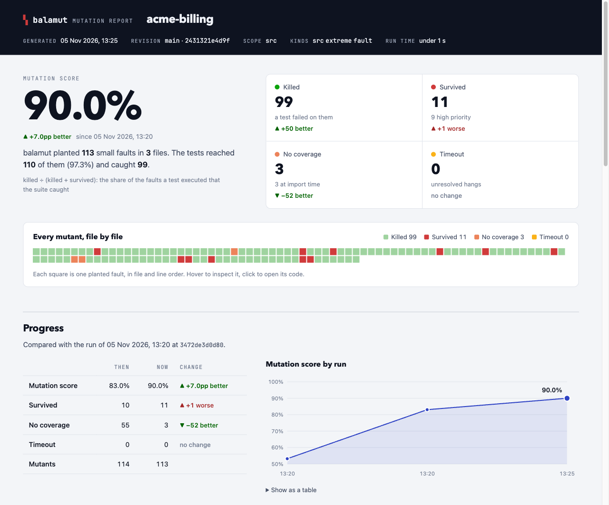

# balamut

**The Python mutator for the AI era** — fast, verdict-exact mutation testing for pytest suites.

balamut keeps the suite warm in pytest-fast daemons and runs each mutant against **only the tests that cover
it**, killer-first and stop-first. Every kill is proven against the paired original — a flaky failure never
counts — and coverage is line-level per test: a line that no covering test actually executes is uncovered, never
a false survivor. The verdict store is cached by content, so a changed test re-judges only the mutants it
touches and a fully cached campaign re-runs in seconds.

balamut mutating its own 5,529 mutants over its own 2,000-test suite: **99% killed**, ~8 minutes cold, ~40
seconds fully cached.

A branch changed `age >= 18` to `age >= 21` and `return high` to `return min(high, value)`; no test checks the new
boundary and no test reaches the second line:

```console
$ balamut diff --base main
balamut diff: FINDINGS
counts: {"cache_resolved": 0, "enumerated": 7, "executed": 4, "killed": 2, "no_coverage": 3, "survived": 2, "timeout": 0, "unsupported": 0}
time: substrate=0s mutation=0s total=1s
substrate-miss: missing_coverage
gate: unresolved=0 actionable=2 uncovered=3 lines=2
NO_COVERAGE src/pkg/calc.py:5 [call:min->max, extreme:sdl, return:None]
SURVIVED src/pkg/calc.py:10 [compare:GtE->Gt, const:num:21->22]
next: fix_findings_and_rerun
```

## Why another mutation tester

* **Speed comes from not repeating work.** A daemon collects the suite once and keeps its workers (and their
  session fixtures) warm across mutants. Each mutant runs only its covering tests, ordered by known killers and
  measured cost, and the request stops at the first failure. Verdicts are cached by content: a mutant is re-run
  only when the code its tests actually executed changes.
* **Every verdict is proven.** A kill counts only when the killing test passes on the immediately restored
  original. A warm survivor whose run never entered the mutated code is re-checked in a fresh fork. A hang is a
  kill only when the mutant ran, the hung test is known and it passes on the original in the same budget.
  Anything else stays `timeout` with a reason; an unsupported mutant is never reported as a survivor.
* **Diffs are pinned.** The gate pins the diff against a merge base with content hashes. Editing a file of the
  scope while the gate runs stops it as `SCOPE_CHANGED` instead of mixing revisions in one verdict.

## Requirements

* Python 3.14+ (the bytecode fast path and `sys.monitoring` events it relies on are version specific).
* pytest 9.1+ and pytest-fast 0.16 (installed as dependencies).
* `capability` 1.0+ (installed as a dependency: the operator API is built on its folds and phases).
* A POSIX system: daemons talk over Unix sockets and are managed as process groups.
* git, for the diff gate.

## Install

```console
$ pip install balamut                # or: uv add --dev balamut
$ pip install 'balamut[sa]'          # + the db / chain operator kinds (ast-grep)
```

## Quick start

A conventional `src/` + `tests/` project needs no configuration; `balamut new` writes it explicitly
(the layout the directory tree implies and the live integration branch as the diff base):

```console
$ balamut new                         # pyproject wiring + the config file
$ balamut diff                       # gate the current branch against origin/main
$ balamut diff --base main --mode full
$ balamut mutate src/pkg/billing.py  # a campaign over paths; builds or refreshes the coverage substrate first
$ balamut live src/pkg               # the same with a live dashboard and an ETA by covering-test cost
$ balamut estimate src/pkg           # how long would it take?
$ balamut substrate                  # the substrate alone: per-test coverage of the current tree
$ balamut doctor                     # read-only check of the substrate, the isolation target and the preflight
```

After `balamut diff` reports a survivor, write the test and confirm it kills the mutant:

```console
$ balamut confirm src/pkg/calc.py --tests tests/test_calc.py
```

Configure the project in one Python file (see [docs/configuration.md](docs/configuration.md));
a full walkthrough of wiring balamut into an existing project is in
[docs/onboarding.md](docs/onboarding.md) (a real run against attrs):

```toml
# pyproject.toml
[tool.balamut]
config = "balamut_conf.py"
```

```python
# balamut_conf.py
from balamut.config import DatabaseEnv, IsolationKind, IsolationSettings, init

init(
    source=("src",),
    import_roots=("src",),
    tests=("tests",),
    test_patterns=("test_*.py", "*_test.py"),
    base="origin/main",
    preflight=(("make", "db-ready"),),
    isolation=IsolationSettings(
        kind=IsolationKind.POSTGRES_TEMPLATE,
        migrate=("alembic", "upgrade", "head"),
        schema_inputs=("alembic/**", "alembic.ini"),
        env=DatabaseEnv(host="DB_HOST", port="DB_PORT", database="DB_NAME", user="DB_USER", password="DB_PASSWORD"),
    ),
)
```

## Commands

| command | what it does |
|---|---|
| `balamut diff` | The gate: pin the scope, run the preflight, reuse or build the coverage substrate, mutate the diff, gate the verdicts, write one JSON report. |
| `balamut new` | Scaffold the project config: wire `[tool.balamut]` in the pyproject, write the config file with the detected layout and the live diff base. |
| `balamut substrate` | Build or reuse the coverage substrate of the current tree, without git; `--rebuild` forces a new generation. |
| `balamut doctor` | The gate's prerequisites, read-only: substrate integrity and compatibility, isolation target, preflight. |
| `balamut mutate` | A campaign over paths, a diff or a pinned scope; over paths it first refreshes the substrate to the current tree. `--json` prints raw results, `--agent-json` a clustered report, `--html` writes a page for people. |
| `balamut confirm` | Re-run the mutants of some paths after measuring new tests. |
| `balamut live` | `mutate` with a live dashboard: done/total, throughput, verdicts and an ETA weighted by covering-test cost. |
| `balamut estimate` | The expected duration of a campaign, from the substrate's coverage and measured test costs. |
| `balamut analyze` | A summary of the cached verdicts: semantic-tagged survivors, cold versus body no-coverage, distributions. |
| `balamut crosskill` | The kill matrix of a `--cross-kill` campaign: redundant tests, fragile mutants, a minimal killing suite. |

`balamut diff` exits with 0 (`CLEAN`), 1 (`FINDINGS` or `UNRESOLVED`), 3 (`SCOPE_CHANGED`) or 2 (a baseline or
infrastructure failure). Options it does not know are passed on to `balamut mutate`
(for example `balamut diff --daemons 4 --kind src,fault`).

## Mutant kinds

| kind | mutates |
|---|---|
| `src` | comparisons, arithmetic, boolean logic, constants, returns, calls, dropped rounding (`round`, `.quantize`), default arguments |
| `extreme` | whole statements (statement deletion), the strongest signal a test exercises behaviour |
| `concurrency` | lock removal, `with_for_update` drops, and queue claim/settle predicates you configure |
| `fault` | an awaited dependency call raises (commit, flush, ...) or returns the wrong value |
| `oracle` | the tests themselves: weakened assertions, so a test that cannot fail shows up |
| `db` | query predicates and grouping keys dropped one at a time (extra `sa`) |
| `chain` | timezone and filter contracts of call chains (extra `sa`) |

Third-party kinds are ordinary importable packages: the value is a tuple of operator
facts (frozen capability values implementing the `Sites` or `Enumerates` protocol of
`balamut.operators.facts`), wired in by the project's config file under `register`. There is no base class, no
registry beyond that dict and no closed set of kinds: the engine folds facts structurally, computes every byte
span itself, and derives the family, the survivor classes and the behavior flags from the fact.

Most kinds are data — compose the generic pieces of `balamut.operators.kit` (a matcher, a site finder, an
operator name):

```python
# my_operators/__init__.py — a kind wired by the config file under register["precision"]
from balamut.operators.facts import OperatorKind
from balamut.operators.kit import DropArgument, Library, Rewrite, ScaleLiteral, call_of, operator_name

precision_kind: OperatorKind = (
    Rewrite(match=call_of(func="round"), transform=ScaleLiteral(scale=10, index=1),
            operator=operator_name(Library.STD, "builtins", "ndigits-widen")),
    Rewrite(match=call_of(func="round"), transform=DropArgument(index=1),
            operator=operator_name(Library.STD, "builtins", "ndigits-drop")),
)
```

Anything the templates do not cover is one small frozen class with a `sites(ctx)` method (the context's
`ctx.emit(target, mutated, operator)` computes the span; `ctx.node` is the current AST node):

```python
from dataclasses import dataclass
from balamut.operators.facts import EnumContext

@dataclass(frozen=True, slots=True)
class RaiseIfSeen:                      # every `raise X` becomes `raise None`-typed sentinel
    operator: str = "custom:raise-flip"
    family: str = "custom"

    def sites(self, ctx: EnumContext) -> EnumContext:
        import ast
        node = ctx.node
        if isinstance(node, ast.Raise):
            ctx.emit(node, "raise RuntimeError", self.operator, fact=self)
        return ctx
```

See `examples/precision_operator` for the complete data-tier package.

## Reports

`balamut diff` writes one JSON report per run (next to its raw results under `.balamut/diff/`): status, the pinned
scope, substrate reuse and the reason of a miss, counts, findings with their key, span and exact covering tests,
per-stage timings, and on failure the stage, a stable error code and the next action. Install a callable under
the `balamut.sinks` entry-point group to receive every terminal report (for example to keep a history); a failing
sink never changes the result. `balamut mutate --agent-json` emits the same findings clustered for machine
consumption — survivors grouped by mutation with the covering tests to strengthen and the sites to cover — so a
coding agent can read the report, write the tests and re-run the gate on its own.

`balamut mutate --html report.html` also writes a self-contained HTML page for people: the mutation score and verdict
counts, a mosaic of every mutant, scores by mutant kind and risk area, high-priority survivors grouped by idiom, a
sortable file table, and each file's code with its mutants in place (the edit, the killing test or the covering tests
to strengthen). The page needs no network and is built from the campaign's own results, not from the verdict cache; a
failed write is reported on stderr and does not fail the campaign. `balamut diff` and `balamut live` pass `--html` on
to `mutate`. Pass an earlier report as `--html-baseline` to compare the runs: the page shows the changes, draws the
score trend and carries the history forward. The baseline is read before the campaign starts, so one path can serve
as both:

```console
$ balamut mutate src --html report.html --html-baseline report.html
```



## How it works

See [docs/how-it-works.md](docs/how-it-works.md) for the engine, the verdict rules, the substrate and its refresh,
and isolation.

## License

MIT
