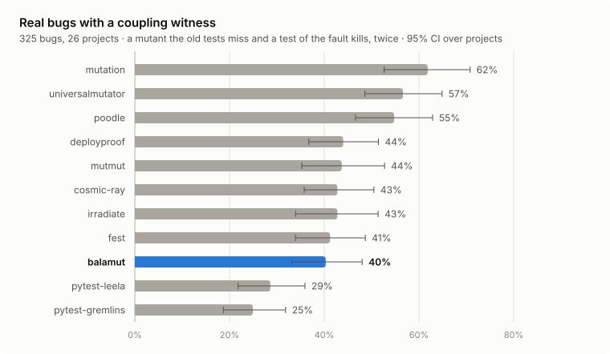
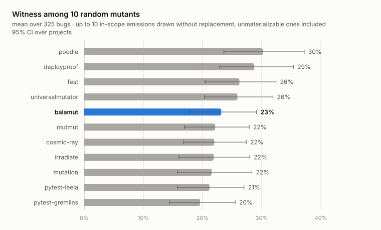
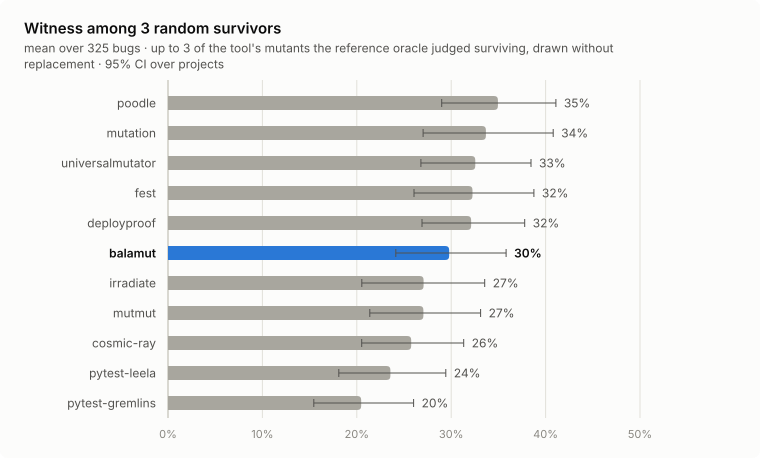
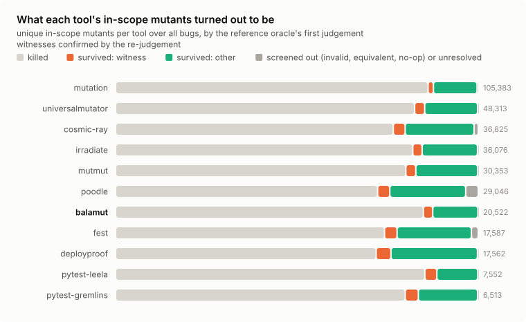
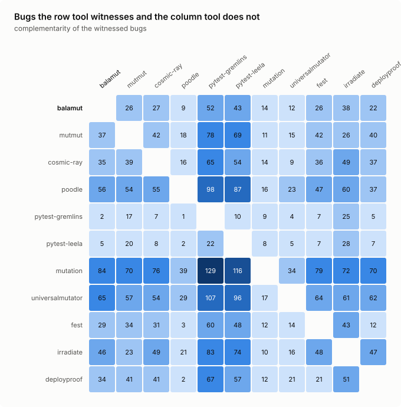
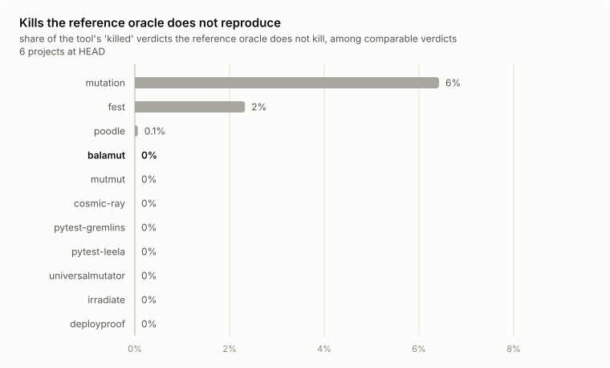
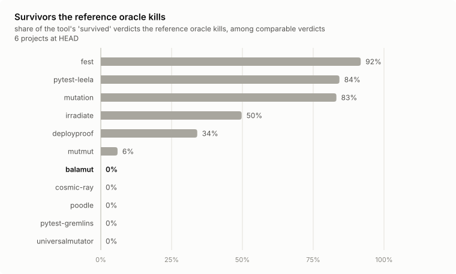
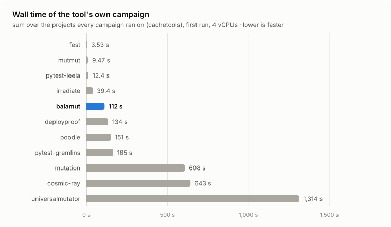
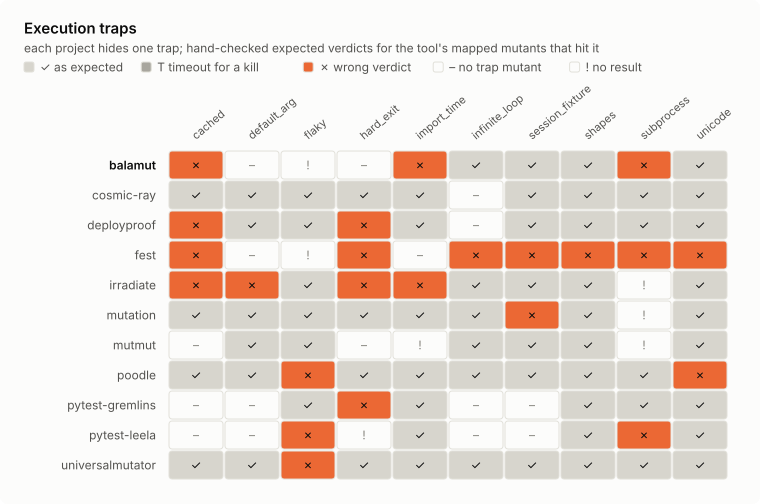

# PyMutBench

PyMutBench measures whether a Python mutation-testing tool points at real bugs: for every validated bug of a
corpus of historical fixes, does the tool generate a mutant that the project's tests miss and the bug's own
regression test catches? It also measures how faithfully each tool's engine judges its mutants, what a
campaign costs, and how each engine behaves on a set of known execution traps. Everything runs on CPython 3.14
in pinned containers; the code, the corpus, every judged mutant and the scripts that produce every table and
figure are in [`bench/`](../bench).

PyMutBench is maintained by the authors of balamut, one of the benchmarked tools. The protocol, the oracle and the
adapters are tool-neutral and published for review; every tool's maintainers can correct its adapter or its
configuration, and a corrected result is published as a new release.

## Results at a glance

* On 325 real bugs from 26 projects, the eleven tools witness 25% (pytest-gremlins) to 62% (mutation) of the
  bugs; all tools together witness 70%.
* At fixed budgets the tools are closer and ordered differently: averaged over bugs, up to ten random in-scope
  mutants of a tool contain a witness with probability 20% to 30%, up to three random survivors with probability
  20% to 35%.
* balamut's default source kinds witness 40% of the bugs, ninth of eleven; the paired intervals of its
  differences from deployproof, mutmut, cosmic-ray, irradiate and fest contain zero. With the extreme kind, which
  `balamut diff` adds on changed code, it witnesses 50%.
* A second judgement from fresh trees reproduced 5,769 of the 5,792 first-judgement candidate witnesses (99.6%);
  the whole historical suite repeated all 998 decided outcomes of a sample of 1,000 shortcut kills.
* In each tool's own campaign on six projects, cosmic-ray, universalmutator, pytest-gremlins and balamut agree
  with the reference oracle on every comparable verdict and poodle on all but one; of the survivors the other
  engines report, the oracle kills 6% (mutmut) to 92% (fest). 12 of the 66 campaigns gave no verdicts or failed,
  1 of them balamut's (toolz).

## What is measured

### Witnessed fault coupling

A mutation tool is useful when the survivors it reports make a developer write the tests that catch real
faults. PyMutBench measures the retrospective form of that claim on real bugs (Just et al., FSE 2014; Kintis et
al., EMSE 2018):

* `F` is the fixed program of a bug, `T_old` the project's test suite as it was just before the fix and
  `T_fix` the fix's fail-to-pass tests (they fail on the buggy program and pass on `F`).
* A mutant of `F` is a **coupling witness** of the bug when `T_old` does not kill it and a test of `T_fix` that
  checks the fault itself (not a feature the same commit added) is red on it, in two independent judgements:
  the historical suite has a gap there, and the test that later caught the real bug also closes that gap.
* A tool **detects** a bug when at least one of its mutants is a witness.

A witness is an opportunity, not a proof of developer benefit: it shows that the tool asked for a test the
real bug needed, not that every test written to kill that mutant would have caught the bug.

### Budgets

A tool that emits more mutants has more chances to produce a witness. Two budgeted measures control for that:

* `R(q)` — the probability that `q` of the tool's in-scope emissions contain a witness (a generation budget; an
  emission that has no faithful source text or does nothing still counts);
* `S(k)` — the probability that `k` of the tool's unique mutants that the reference oracle judges survivors
  contain a witness (an inspection budget; a tool's own engine may report other survivors, which the engine
  track measures).

Both are exact hypergeometric probabilities per bug (draws without replacement, `min(budget, population)` of
them, 0 for an empty population), averaged over bugs.

### Engine truthfulness, cost and traps

The engine track runs every tool's own campaign as its quick start describes and compares each native verdict
with the reference oracle's verdict for the identical mutated file; it reports wall time and memory.
The conformance track runs every tool on small projects with one execution trap each (a flaky test, import-time
code, a session fixture, a test running a subprocess, an infinite loop, `os._exit`, `lru_cache` state, non-ASCII
text before a mutated site, closures, generators and coroutines) against hand-checked expectations.

## The tools

Eleven tools install and run on CPython 3.14 and are benchmarked (pinned releases; every tool in its own
virtual environment, so no pytest plugin of one tool is loaded in another's run):

| tool | version | how its engine runs a mutant |
|---|---|---|
| [balamut](https://github.com/prostomarkeloff/balamut) | 0.1.2 (commit ec352cb) | resident pytest workers, in-memory code patching, coverage-selected tests |
| [mutmut](https://github.com/boxed/mutmut) | 3.8.1 | trampolined function variants, forked workers |
| [cosmic-ray](https://github.com/sixty-north/cosmic-ray) | 8.7.0 | file rewrite, one test-command run per mutant |
| [poodle](https://github.com/WiredNerd/poodle) | 1.4.0 | file rewrite in copied trial folders, parallel |
| [pytest-gremlins](https://github.com/mikelane/pytest-gremlins) | 1.13.2 | mutation switching (instrumented AST), subprocess per gremlin |
| [pytest-leela](https://github.com/markng/pytest-leela) | 0.9.0 | in-process import-hook AST mutation, type-aware operators |
| [mutation](https://github.com/amirouche/mutation.py) | 0.6.0 | pytest plugin installing the patched module, coverage-gated |
| [universalmutator](https://github.com/agroce/universalmutator) | 1.14.1 | regular-expression mutants as files, one test command per mutant |
| [fest](https://github.com/sakost/fest) | 0.1.3 (fest-mutate) | Rust driver, pytest plugin or subprocess backend |
| [irradiate](https://github.com/nwyin/irradiate) | 0.4.3 | Rust driver, trampolines, pre-warmed forked pytest workers |
| [deployproof](https://github.com/SVSPraveen/deployproof) | 1.1.19 | in-memory AST schemata on a diff or explicit files |

Every other tool found is listed with the reason it is not benchmarked; a tool that does not run on
CPython 3.14 is a result, not an omission:

| tool | version | reason |
|---|---|---|
| MutPy | 0.6.1 (last release 2019-11-17) | does not run on CPython 3.14 — `AttributeError: module 'importlib' has no attribute 'find_loader' (removed in Python 3.12)` |
| mutatest | 3.1.0 (last release 2022-02-20) | does not run on CPython 3.11 or later — `TypeError: Population must be a sequence. For dicts or sets, use sorted(d). (random.sample on a set); the CLI also imports setuptools, which is not installed by default` |
| mutahunter | 1.3.2 | does not install on CPython 3.14; LLM-based (paid API) — `tree-sitter-languages 1.10.2 publishes wheels only up to cp312` |
| pyproteum | 0.2.4 | runs unittest suites only; its console entry point fails — `runner_tests.py loads tests with unittest.TestLoader().loadTestsFromModule; `pyproteum` raises ImportError: cannot import name 'main' from 'pyproteum.__main__'` |
| mutation-testing (YeahWick) | 0.1.0 | mutations are written by the user, not generated |
| pytest-mutagen | 1.3 (2020) | mutations are written by the user, not generated |
| typemut | 0.5.0 | mutates type annotations to assess a type checker, not a test suite |
| mutator (unclebob) | GitHub only | not installable as a package: needs a sibling checkout of the crapper repository and writes uml-viewer snapshots |
| pyllmut | 0.6.0 | LLM-driven generator library needing a paid model API; not part of this release |
| interlocks-mutmut | 3.5.1 | a republication of mutmut |
| xmutant, pymutester, mutant | last releases 2017, 2011, 2010 | unmaintained for the Python versions in scope |

## The corpus

27 pure-Python libraries with pytest suites that run on CPython 3.14 (from packaging, attrs, click and rich to
pyparsing, more-itertools and python-dateutil) yield 1,725 candidate fixes since 2021. 1,590 were validated
(packaging and cattrs only as far as their 15 bugs required, see [Selection](#selection)), 722 admitted,
523 adjudicated, 386 labelled a bug and 382 admitted again by the final protocol. The corpus is the first 15 of
them per project: **325 bugs from 26 projects** (python-dateutil keeps none).

The fixes are small: 296 change one source file, 24 two and 5 three, with a median of 7 changed lines (at most
39). A bug's regression suite `T_fix` has a median of 2 tests; its historical suite `T_old` a median of 741 tests
(from 64 to 62,492). By the raters' fault classes, the most common are a missing or wrong condition (91), string
formatting or a regular expression (61), call arguments or API use (32) and type or `None` handling (32).

| project | candidates | validated | admitted | adjudicated | labelled bug | re-admitted | in the corpus |
|---|---|---|---|---|---|---|---|
| arrow | 39 | 39 | 29 | 29 | 14 | 14 | 14 |
| attrs | 93 | 93 | 29 | 25 | 16 | 16 | 15 |
| boltons | 57 | 57 | 33 | 25 | 23 | 23 | 15 |
| cachetools | 40 | 40 | 18 | 18 | 9 | 9 | 9 |
| cattrs | 119 | 67 | 36 | 28 | 15 | 15 | 15 |
| click | 99 | 99 | 70 | 25 | 18 | 18 | 15 |
| dateutil | 23 | 23 | 1 | 1 | 1 | 0 | 0 |
| humanize | 51 | 51 | 15 | 15 | 12 | 12 | 12 |
| inflect | 36 | 36 | 18 | 18 | 16 | 16 | 15 |
| jinja2 | 26 | 26 | 9 | 9 | 7 | 7 | 7 |
| marshmallow | 48 | 48 | 28 | 25 | 18 | 18 | 15 |
| mistune | 62 | 62 | 41 | 25 | 23 | 22 | 15 |
| more-itertools | 106 | 106 | 34 | 25 | 21 | 21 | 15 |
| packaging | 167 | 84 | 70 | 25 | 21 | 21 | 15 |
| parse | 23 | 23 | 19 | 19 | 14 | 14 | 14 |
| portion | 16 | 16 | 8 | 8 | 4 | 4 | 4 |
| pyflakes | 41 | 41 | 12 | 12 | 7 | 7 | 7 |
| pyparsing | 118 | 118 | 26 | 25 | 18 | 18 | 15 |
| python-dotenv | 30 | 30 | 19 | 19 | 12 | 12 | 12 |
| python-pathspec | 60 | 60 | 14 | 14 | 11 | 11 | 11 |
| python-semver | 19 | 19 | 14 | 14 | 13 | 13 | 13 |
| python-tabulate | 55 | 55 | 20 | 20 | 14 | 14 | 14 |
| pyupgrade | 80 | 80 | 21 | 21 | 11 | 11 | 11 |
| rich | 142 | 142 | 37 | 25 | 24 | 22 | 15 |
| sqlparse | 44 | 44 | 35 | 25 | 19 | 19 | 15 |
| tomlkit | 124 | 124 | 63 | 25 | 23 | 23 | 15 |
| toolz | 7 | 7 | 3 | 3 | 2 | 2 | 2 |
| **total** | **1,725** | **1,590** | **722** | **523** | **386** | **382** | **325** |

Every selected bug was judged, and no bug was excluded after selection: each kept a fail-to-pass test that
checks the fault and an eligible baseline.

## Protocol

### Environment

All third-party code runs in Docker images built `FROM python@sha256:f1b121a9…` (CPython 3.14.10, Debian trixie,
arm64), with uv 0.9.21 and the network disabled except for image builds; a judging container may use 2.5 GB of
memory and no swap. One image per subject installs its test dependencies at the repository's HEAD; the
subject's own packages are imported from each judged tree through `PYTHONPATH`, and every run verifies that they
were imported from that tree. Every pytest run is a fresh interpreter in a new process group with a fixed hash
seed, no bytecode writes, UTC, a private `HOME` and `TMPDIR`, a 60-second per-test limit (`faulthandler`), a
derandomized Hypothesis profile without example database, and `-W ignore::pytest.PytestRemovedIn10Warning`, the
one compatibility adaptation applied to every subject: historical tests written against an older pytest
otherwise fail to collect under a `filterwarnings = error` configuration. A plugin records each test's outcome:
a test is red when any of its phases fails, a failed subtest (`unittest`'s `subTest`, the `subtests` fixture)
included, as pytest itself counts it.

### Mining and validation

A candidate is a first-parent commit since 2021 that changes at most three source files of the subject's
packages by at most 40 lines and changes at least one test file. Four trees are built: `fixed` (the commit),
`buggy` (the commit with its source files reverted), `old` (the parent's tests with the fixed source) and
`parent`. A candidate is admitted when:

1. some test of the fix's changed test files passes on `fixed` and fails on `buggy` for a behavioural reason
   (an assertion or an exception; a missing name, a changed signature or a module that no longer imports marks
   a new API, not a fault). A test that hangs past the per-test limit is recorded as a crash, which is not a
   behavioural reason (see [Threats to validity](#threats-to-validity));
2. those tests keep their outcome and their failure class over two more runs on each tree (`T_fix`);
3. the historical suite runs to completion without collection errors three times on `old` and once on
   `parent`; `T_old` is the set of tests green in all four runs (the others are excluded, not fatal), and a
   candidate is rejected when a test green in all three `old` runs fails on `parent` (the historical suite would
   have caught the fault).

### Adjudication

A test that fails before a commit and passes after it shows a behaviour change, not a fault. Every admitted
candidate is labelled `bug`, `feature`, `behavior_change` or `unclear` by two independent raters under one
rubric ([`bench/pymutbench/review.py`](../bench/pymutbench/review.py)): rater B (Claude Opus agents) and rater
C (Claude Sonnet agents), each seeing only the commit message, the source diff, the test diff and the
fail-to-pass outcomes, never the other rater or any tool result. A candidate both label `bug` is a bug; one both
label otherwise is rejected; a disagreement goes to a third rater of another model family (GPT-6-Astra,
medium reasoning effort), whose vote decides. The raters also classify the fault.

B and C labelled 526 admitted candidates: the 523 the final screening admitted and 3 older cattrs candidates
from an earlier screening run, past the point where cattrs's screening stopped (they are not in the corpus).
They agreed on bug versus not-bug for 479 (91.1%, Cohen's κ 0.77):
364 bugs and 115 non-bugs. The third rater decided the 47 disagreements, 25 of them as bugs; 30 of the 47 were
"behavior_change" for B and "bug" for C. In all, 389 candidates are bugs. On 85 candidates that GPT-6-Astra
(high effort) also labelled, its agreement with B and C was κ 0.87 and 0.90. B and C gave the same fault class
to 244 of the 364 bugs they both labelled. Every label, the votes behind it and the agreement statistics are in
[`results/final.jsonl`](../bench/results/final.jsonl) and [`results/agreement.json`](../bench/results/agreement.json).

A fix commit can also change other behaviour. For every selected bug a Claude agent marked, under a second
rubric, which fail-to-pass tests check the fault itself; only those tests can make a witness. A bug whose tests
all check something else is dropped.

### Selection

Candidates are processed in mainline order, newest first: validation, adjudication of the admitted
candidates, then re-validation of the bugs with the final protocol (the first validation pass screened the
history with an earlier revision of the protocol; a bug enters the corpus only if the final protocol admits it
again). The corpus takes, per project, the first 15 candidates in that order that pass all three. Because
every step follows the same order, a project's processing may stop once its 15 are found: an older commit
cannot displace them. [`results/selection.json`](../bench/results/selection.json) records per project how many
candidates were mined, validated, admitted, adjudicated, labelled a bug, re-admitted and selected, and lists
every candidate that leaves a selection incomplete.

### Scope and generation

The scope of a bug is the set of definitions of the fixed file that the fix touched: the innermost function
containing a changed line, else the class-body or module statement containing it. Every tool generates mutants
for the whole file with its own generator and default operators; the same scope filter then keeps the mutants
whose edit lies inside the scope. A native mutant becomes an artifact: the complete mutated file, as one
byte-precise edit of the original; identical mutated files from several tools are judged once.

* Text-level tools are taken as emitted (`balamut`, `fest`, `universalmutator` files, `cosmic-ray` through
  `mutate_code`, `poodle` through its own `mutate_lines`, `mutmut` through its own function replacement,
  `irradiate` from its generated function variants; its decorator removals and source-patch mutants of
  decorated functions appear only in a test run's report and are missing, see
  [Threats to validity](#threats-to-validity)).
* AST-level tools (`pytest-gremlins`, `pytest-leela`, `mutation`, `deployproof`) are materialized as the
  smallest source edit that reproduces the tool's mutated tree, accepted only if it parses to that tree or
  compiles to the same bytecode. `pytest-leela` applies the operator categories its plugin enables (by default
  arithmetic, comparison, boolean, unary and return); `deployproof` resolves the schemata module its engine runs
  with one mutant switched on at a time.
* `mutation` mutates only lines its coverage run executed; its set is gated with the historical suite's
  executed lines. Its random literals are drawn with a fixed seed.

Every native mutant is accounted for: emitted, materialized, unmaterializable with a reason, in or out of scope.
An adapter skips, before materializing, a candidate whose edit cannot lie in the scope (for `deployproof`, a
mutation site outside it; for `fest` and `balamut`, a replaced byte range outside it); on the bugs compared, the
in-scope sets equal those of unfiltered runs. A tool command killed by the container's out-of-memory killer is
repeated once; a tool that fails on a file fails its adapter, and the ledger records the failure: the tool is
then unavailable for that bug, which counts as not detected (and 0 in `R` and `S`) in the operational measures
and leaves only the conditional rate's denominator.

balamut's ranking row uses the source kinds `balamut mutate` runs by default (src, concurrency, fault; its default
`oracle` kind mutates tests, outside a source scope), the file-level default configuration every other tool gets
and the one of its engine-track campaign. The `extreme` kind, which `balamut diff` adds by default on changed
code, is generated too and reported as the variant "balamut + extreme", outside the ranking and the comparisons:
it measures that kind under the benchmark's scope and oracle, not the `balamut diff` workflow.

### The reference oracle

For every artifact the oracle:

0. marks it `noop` if the file is unchanged, `invalid` if it does not compile, and `equivalent_tce` if its
   bytecode equals the original's (instructions with resolved arguments, the exception table and argument
   counts; line tables ignored);
1. runs, each alone, the (at most two) covering historical tests that most often killed earlier mutants of the
   file; a kill counts only if the same single-test run is green on the unmutated tree;
2. runs the historical tests that executed the mutated lines on the unmutated tree (`-x`); a red test kills only
   if it is green when the same subset runs on the unmutated tree;
3. runs the whole historical suite in its canonical order (`-x`); a complete green run with the expected number
   of tests is a survivor. A mutant no test executes (module- or class-level code runs at import) goes straight
   here;
4. runs `T_fix` in the fixed tree for a survivor; a red `T_fix` test makes it a witness.

A collection error or a stop before any test counts only when a repeat of the same run shows it again; a run
whose outcome the oracle cannot interpret is `unresolved`, never a verdict. A run killed from outside the
harness (a SIGKILL, such as the container's out-of-memory killer) is repeated once and otherwise counts as
unknown, so it can make neither a kill nor a witness: a mutant whose whole-suite run is killed again, or reports
a failure without any red test, is `unresolved`. Every oracle invocation re-checks the baselines before any
mutant, a resumed one included: tests red on the unmutated tree are excluded for that invocation and `T_fix`
tests red on the fixed tree are dropped; a bug left without `T_fix` is ineligible. The retained historical tests
can therefore differ between invocations of one bug; in the corpus they differ for one bug (rich@b6aae7c342b2,
see [Threats to validity](#threats-to-validity)).
The historical baseline also records which lines each test runs; that recorder can fail after the last test
when a test leaves a thread running, and a baseline left without its end record is run again, up to five times
(two pyparsing bugs needed it: one once, one twice).

Every witness is then judged again by a second oracle process from freshly built trees, with the whole
historical suite in canonical order and then `T_fix`; a witness counts only when this second judgement repeats
it with a red fault test. The shortcuts of steps 1 and 2 are measured too: a uniform, seeded sample of 1,000
mutants they killed is judged again by the whole suite alone.

Every container mounts an immutable snapshot of the harness code; generation ledgers carry a fingerprint of the
code behind each tool's adapter and oracle results one of the oracle's code, together with the image identity.
`report` refuses mixed fingerprints, an incomplete selection, a selected bug without a purity label, a tool
artifact without a verdict, a witness without a re-judgement or an incomplete shortcut sample. The real-bug
verdicts carry oracle fingerprint `ecd9f95dcc8ee860`; the engine and conformance verdicts carry
`33a67b4e3a1f1650`, whose code adds the suite mode's test roots and writes no empty argument for a pytest run
without targets. Bug mode never runs pytest without targets (every one of the 325 bugs has a test root), so the
real-bug verdicts do not depend on the difference.

### Engine and conformance tracks

The engine track measures each tool's own engine on six projects at HEAD, one or two files each:
`src/semver/version.py` (python-semver), `src/cachetools/__init__.py` (cachetools), `src/humanize/number.py`
(humanize), `toolz/itertoolz.py` (toolz), `sqlparse/utils.py` and `sqlparse/filters/others.py` (sqlparse),
`src/attr/validators.py` and `src/attr/converters.py` (attrs). One image per project installs the project
editable into every tool's own virtual environment, with the test dependencies its suite needs at HEAD
(humanize: pytest-codspeed, whose `benchmark` fixture calls a benchmarked function once outside a CodSpeed
run). Neither track compiles humanize's message catalogues (`scripts/generate-translation-binaries.sh`), so its
suite skips the translation tests that need them: at HEAD 132 tests, beside 2 that need `xgettext`. A fresh
container runs each
campaign as the tool's documentation describes, restricted to those files and the project's test roots:

| tool | campaign |
|---|---|
| balamut | `balamut new`, then `balamut mutate FILES --json` (default kinds) |
| mutmut | `[tool.mutmut]` with `source_paths` as mutmut guesses them in a checkout named after the project (`src` in a src layout, else the package directory), the files as `only_mutate` and the test roots as `pytest_add_cli_args_test_selection`, then `mutmut run` |
| cosmic-ray | the files as `module-path`, a 60 s timeout, `python -m pytest -x -q TESTS` as test command, the local distributor; `init`, `baseline`, `exec` |
| poodle | `json_report_found = true` in `poodle.toml` (its JSON report otherwise lists only the mutants the tests did not find), then `poodle IMPORT_ROOTS --only FILE_NAMES --json poodle.json`, where an import root is the directory a package is imported from (`src`, or `.` in a flat layout: poodle puts its copy of each source folder on `PYTHONPATH`) |
| pytest-gremlins | `pytest --gremlins --gremlin-targets=FILES TESTS` |
| pytest-leela | `pytest --leela --target FILE TESTS` |
| mutation | `mutation play --include=FILE --exclude=*test* TESTS` |
| universalmutator | `mutate FILE python`, then `analyze_mutants FILE "python -m pytest -x -q TESTS"` |
| fest | `fest run -s FILE -o json` |
| irradiate | `irradiate run FILES --tests-dir TESTS --python VENV_PYTHON --report json` |
| deployproof | `deployproof check --files FILES --tests TESTS --json` |

Before each campaign the project's suite runs once in the tool's environment (the control run). A campaign's
container has 4 vCPUs, 3 GiB of memory and no swap. A campaign is timed from its first command to its last: wall
time and the container's memory peak (cgroup `memory.peak` since the container started, control run included: the
VM's Linux 6.10 cannot reset it), which counts every process the campaign starts and the page cache of the files
they read and write. The CPU time of the processes it waited for is recorded but not compared: it misses workers
that no waited-for process reaps (balamut and poodle record seconds of CPU time for campaigns of minutes). Each
command of a campaign may run 2 hours (10 minutes on a trap fixture, whose suite runs in at most 0.03 s), the
whole campaign 4. A campaign that ends without a report is `failed`, and one whose tool gave none of its mutants
a verdict (killed, survived, timeout, no coverage) is `no verdicts`, with the tool's last exit status and the
error its report gives or its last output line; neither is run again. Every native mutant is mapped through the
tool's generation adapter to the artifact of the identical mutated file. A mutation mutant no enumerated mutant
matches (its number literals take random values, drawn in worker processes that Python reseeds at every fork, so
no seed reproduces them) is materialized from its own mutated program. irradiate's report gives each mutant's
location and the text it replaced; two of its locations are systematically off (a method signature's columns by
the method's indentation, a decorated function's source patches by its decorator lines), and the edit counts
only where the replaced text is. deployproof's report lists its survivors (file, line, description, mutated line)
and only counts its kills: a survivor maps to the adapter mutant with its mutated line, else, with the other
survivors of its line and description, to as many adapter mutants of that line and description; the kills map
only when every survivor maps, the counts add up to the adapter's enumeration and no runner error occurred, and
otherwise count as verdicts without an artifact. The reference oracle judges the union of all campaigns'
artifacts with the staged procedure above, on the project's test roots at HEAD (the tests the campaigns run) and
without the fail-to-pass step; the unmutated tests run five times first, and only tests green in all five may
kill. A native verdict then agrees with the oracle's, is a kill the oracle does not reproduce, or a survivor the
oracle kills; a mutant the tool ran no test for is compared apart, and timeouts, errors and skips are the tool's
own non-verdicts.

The conformance track runs every campaign on ten small projects with one trap each and compares the verdicts
of the mutants that hit the trap with hand-checked expectations
([`bench/conformance/expectations.json`](../bench/conformance/expectations.json)); a mutant that hits the trap
but whose mutated file does not compile is wrong whatever the tool's verdict, since the verdict judges a broken
file.

### Statistics

The unit of analysis is the bug, nested in its project. Rates are pooled over bugs with pointwise 95% intervals
from a bootstrap over projects (10,000 replicates). The primary rate is operational: a bug on which a tool's own
generator failed counts as not detected. The rate over the bugs each tool's generation succeeded on, the
failures and their evidence are published beside it. Paired comparisons with balamut report the discordant
counts, the project-bootstrap interval of the paired difference (the primary inference) and the McNemar mid-p
with Holm's adjustment over the comparison family (descriptive: it ignores the clustering, and a mid-p does not
guarantee its nominal level).

Fixed before any witness was confirmed, the sensitivity analyses are: the mean of per-project rates; every rate
with each project left out in turn (the range) and without arrow, 12 of whose 14 bugs fix `arrow/locales.py`
(9 of the 14 are wrong literals or constants by the raters' fault classes); and every rate split by where the fix
is (inside functions, or in class-body and module-level statements, which several tools never mutate).

## Results

Every number below is computed from the published data by `python3 -m pymutbench.report bugs` (the real-bug
track; table twins of the figures in [`results/tables.md`](../bench/results/tables.md)) and by
`python3 -m pymutbench.report_engine` (the engine and conformance tracks;
[`results/engine.md`](../bench/results/engine.md)).

### Detection

<picture>
  <source media="(prefers-color-scheme: dark)" srcset="images/bench-detection.dark.svg">
  
</picture>

Every tool's generator succeeded on every bug, so the operational and conditional rates coincide. The tools
witness between 25% and 62% of the 325 bugs, and together 70% (226 bugs):

| tool | bugs witnessed | rate (95% CI) |
|---|---|---|
| mutation | 201 | 62% (53–71%) |
| universalmutator | 184 | 57% (49–65%) |
| poodle | 178 | 55% (47–63%) |
| deployproof | 143 | 44% (37–51%) |
| mutmut | 142 | 44% (35–53%) |
| cosmic-ray | 139 | 43% (36–50%) |
| irradiate | 139 | 43% (34–51%) |
| fest | 134 | 41% (34–49%) |
| balamut | 131 | 40% (33–48%) |
| pytest-leela | 93 | 29% (22–36%) |
| pytest-gremlins | 81 | 25% (19–32%) |

balamut's default kinds witness 131 bugs, ninth of eleven. The paired project-bootstrap differences place it
below mutation (−21.5 points, 95% CI −29.6 to −13.8), universalmutator (−16.3, −23.0 to −9.8) and poodle
(−14.5, −20.9 to −8.8), and above pytest-leela (+11.7, +7.5 to +16.0) and pytest-gremlins (+15.4, +10.7 to
+19.7). The intervals of its differences from deployproof (−3.7, −11.1 to +2.6), mutmut, cosmic-ray, irradiate
and fest contain zero: their order is uncertain. The intervals are pointwise, not simultaneous statements about the
whole ranking. As the variant "balamut + extreme", balamut witnesses 161 bugs (50%, 42–57%) with a median of 33
in-scope emissions per bug instead of 25.

### Budgets

<picture>
  <source media="(prefers-color-scheme: dark)" srcset="images/bench-budget-r10.dark.svg">
  
</picture>

<picture>
  <source media="(prefers-color-scheme: dark)" srcset="images/bench-budget-s3.dark.svg">
  
</picture>

Unrestricted detection spans 25% to 62%; at fixed budgets `R(10)` spans 20% (pytest-gremlins) to 30% (poodle)
and `S(3)` 20% to 35% (poodle), and the order depends on the budget. The median bug gets 133
in-scope emissions from mutation, 56 from universalmutator, 25 from balamut and 8 from pytest-gremlins.
balamut's `R(10)` is 23% (mutation's 22%) and its `S(3)` 30%, sixth. Pooled over bugs, 531 of balamut's 3,098
survivors are witnesses (17%), against 1,558 of mutation's 14,286 (11%); with every bug weighted equally, `S(1)`
is 18% for balamut and 19% for mutation.

### What the mutants turned out to be

<picture>
  <source media="(prefers-color-scheme: dark)" srcset="images/bench-accounting.dark.svg">
  
</picture>

The reference oracle kills 72% (deployproof, poodle) to 86% (mutation) of each tool's unique in-scope mutants;
balamut's share is 85%. Mutants that do not compile are 3.4% of poodle's (989) and 1.0% of cosmic-ray's (372), at most
0.6% for the others; bytecode-equivalent ones at most 1.2% (fest, 215). The tools' sets hold 219,987 bug–artifact
pairs (mutated files deduplicated across tools within each bug). 180 of them (0.08%) have an unresolved
historical-suite outcome: the run was killed from outside the harness in both attempts, 102 of them in cattrs.

### Complementarity

<picture>
  <source media="(prefers-color-scheme: dark)" srcset="images/bench-overlap.dark.svg">
  
</picture>

On this corpus, every tool of every pair witnesses at least one bug the other misses. mutation witnesses 84
bugs that balamut misses, balamut 14 that mutation misses. 9 bugs have a single witnessing tool (mutation 3,
universalmutator 2, poodle, deployproof, mutmut and cosmic-ray 1 each), and the union of all tools (70%) is
7.7 points above the best single tool.

### Strata and sensitivity

Detection rates differ across the strata. On the 38 bugs whose fix lies only in class-body or module-level
statements, mutmut, irradiate and pytest-gremlins witness 11%, balamut and pytest-leela 13% and cosmic-ray 16%,
against 29% to 58% for universalmutator, fest, poodle, deployproof and mutation. The coverage strata are
retrospective, and the fail-to-pass run includes feature tests. On 222 bugs the fail-to-pass run executes at
least one changed line and the historical suite executed every such line; there the rates are 9%
(pytest-gremlins) to 52% (mutation), balamut's 23%. On the other 103 they are 59% to 88%: 97 bugs with a changed
line the historical suite never executed, and 6 whose fail-to-pass run executes none of the changed lines.

The sensitivity analyses fixed in advance move the absolute rates modestly: by at most 2.4 points when one
project is left out, 1.8 with every project weighted equally and 1.9 without arrow. Close rankings can change:
without arrow, deployproof (42.1%) falls behind mutmut, cosmic-ray and irradiate, and balamut (40.8%) moves
ahead of fest (39.5%). Counting every undecided mutant (an unresolved run, a
survivor without a fail-to-pass outcome, a witness without a re-judgement outcome) as a witness raises a rate by
at most 3.1 points (the optimistic rates in [`results/tables.md`](../bench/results/tables.md)).

### Reliability of the verdicts

* **Witness re-judgement.** A second oracle process from fresh trees reproduced 5,769 of the 5,792
  first-judgement candidate witnesses (99.6%). Of the other 23, 22 were killed by the historical suite: 19 by
  rich's pipe test and 1 by a mistune CPU-time test (see [Threats to validity](#threats-to-validity)), 2 by
  ordinary tests of python-pathspec and tomlkit. The last one, a rich mutant, survived with a green fail-to-pass
  test, which failed on it in 2 of 3 later runs alone. A published witness also needs the same fail-to-pass test
  red with an outcome of its own in both judgements, and that test checking the fault. The check covers the
  candidate witnesses only; it does not estimate the accuracy of all verdicts.
* **Oracle shortcuts.** Of 1,000 kills by a single test or the covering subset, drawn uniformly (seed
  20261105) from 157,058 over 207 bugs, the whole historical suite alone killed 998; 2 runs were killed from
  outside in both attempts, and none survived. The suite repeated every decided kill (998 of 998), so the
  disagreement rate is below 0.3% with 95% confidence (one-sided), at most about 470 of the 157,058 kills. The
  sample covers shortcut kills, not survivors or witnesses. 1,315 of the 157,058 kills, 2 of them sampled, are of
  mutants that only earlier versions of the pytest-leela and deployproof adapters generated: they judge the
  oracle, not a tool.
* **Undecided.** 180 of the 219,987 bug–artifact pairs (0.08%) have an unresolved historical-suite outcome, 3
  survivors have no fail-to-pass outcome (an interrupted run in click, pytest exit status 2; two external kills
  in pyparsing).

### Engines: verdicts and cost

<picture>
  <source media="(prefers-color-scheme: dark)" srcset="images/bench-engine-false-kills.dark.svg">
  
</picture>

<picture>
  <source media="(prefers-color-scheme: dark)" srcset="images/bench-engine-false-survivors.dark.svg">
  
</picture>

<picture>
  <source media="(prefers-color-scheme: dark)" srcset="images/bench-engine-time.dark.svg">
  
</picture>

Of the 66 planned campaigns (eleven tools on six projects), 54 ran, 10 gave no verdicts and 2 failed;
[`results/engine.md`](../bench/results/engine.md) lists every campaign with its reason, its native verdicts and
their comparison. Where their campaigns ran, cosmic-ray, universalmutator, pytest-gremlins and balamut agree with
the reference oracle on every comparable verdict (3,230, 5,445, 842 and 1,567). poodle agrees on 1,830 of 1,831:
it kills a toolz mutant (`len(seq) % n` → `len(seq) - n` in `partition_all`) that the oracle and the campaigns of
cosmic-ray, mutation and universalmutator, which generate the same mutated file, find surviving; that kill is not
traced. The other disagreements and every campaign without verdicts trace to mechanisms of the tools, except
where noted:

* **fest** runs every mutant through its default backend, a pytest plugin that patches the module in a
  long-lived pytest process; 771 of its 840 comparable survivors are oracle kills. Its subprocess backend agrees
  with the oracle on toolz. A module `def f(x): return x + 1` with the test `assert f(1) == 2` reproduces it:
  every mutant survives under the plugin and none under the subprocess backend. Its 13 kills that the oracle does
  not reproduce are not traced.
* **pytest-leela** stops a mutant only between tests (its timer sets a flag its pytest hook reads before each
  test), so a mutant that loops inside a test hangs the campaign: toolz (`partition_all`) and sqlparse
  (`token_index`) failed at the 2-hour limit. For `--target src/cachetools/__init__.py` it names the module
  `cachetools.__init__`, which no import loads: all 195 mutants survive unapplied, 182 of them oracle kills.
* **mutation** installs a mutant when pytest configures its plugin: it executes the mutated module in a new
  module object (an empty one when that raises) and then registers it in `sys.modules`. On cachetools (a relative
  import) and humanize (an `ImportWarning` that the project's `filterwarnings = error` raises) every mutant is
  "killed", 447 of them oracle survivors. It runs `os.cpu_count() - 1` mutants at once in one directory (13: the
  container shows 14 CPUs), and python-semver's `--cov=semver` makes every run write the same coverage file:
  concurrent runs crash with pytest's internal-error status (`no such table: meta`), which mutation counts as a
  kill, and 92 of its 1,387 comparable kills there are oracle survivors. A package imported before the
  registration keeps the original module: python-semver's conftest imports `semver` before the plugin is
  configured, and sqlparse's `filters/others.py` and toolz's `itertoolz.py` import their own package while they
  execute, which then imports the original file from disk. 1,623 of its survivors are oracle kills: 977 on
  python-semver, 638 on sqlparse, where every mutant of `others.py` survives, and 8 on toolz, where the names
  `toolz` re-exports and `recipes.py` imports stay the originals. Its test command passes `--assert=plain` too,
  so on attrs its check of the unmutated suite fails on `test_hash_mirrors_eq` (see poodle) and it generates no
  mutant. Its number-literal mutants take random values drawn in worker processes that Python reseeds at every
  fork, so its campaign is not reproducible even with `--randomly-seed`; 87 of its mutants (mutated trees with no
  faithful source edit) stay unmapped.
* **irradiate** installs no trampoline in a class that defines a nested class, so the mutants of its methods
  never run: on cachetools (LFUCache, `_TimedCache`, TTLCache and TLRUCache) none of them is killed, and they are
  236 of its 277 survivors that the oracle kills and 249 of its 376 "no coverage" mutants that the oracle kills.
  The other "no coverage" kills are mostly of methods that only the interpreter calls (constructors,
  subscription, `in`, iteration, properties). Its trampoline keeps the original signature and passes every
  argument on explicitly, so a mutated default value never takes effect: 39 of the other 41 survivors that the
  oracle kills, and 7 of the 236, are such mutants. Of the last two, one changes a condition whose effect depends
  on which item RRCache evicts at random (see the oracle's repeatability below) and one is not traced. On
  python-semver its stats run ended with pytest's internal-error status (`Stats run failed (exit code 3)`), so it
  gave no verdicts; an earlier run of the same campaign completed, and 66 runs of the stats phase in diagnostic
  containers did not fail.
* **poodle**'s default test command is `pytest -x --assert=plain -o pythonpath=…`. Its `-o pythonpath`
  replaces python-semver's `.pytest.ini` setting `pythonpath = src tests`, so the unmutated suite fails
  (`No module named 'coerce'`). Under `--assert=plain` attrs's `test_hash_mirrors_eq` fails: it asserts
  `hash(C(1)) != hash(C(1))` for a class hashed by identity; pytest's assertion rewriting keeps the first instance
  in a variable while the second is created, a plain assert frees it first, and CPython gives the second
  instance its memory and so its hash. On neither project does poodle judge a mutant.
* **mutmut** copies python-semver's tests without its `.pytest.ini`: pytest in `mutants/` reads the parent
  directory's configuration, imports the original package and finds no test for any mutant. On humanize and attrs
  its clean run fails, since mutmut calls `pytest.main` twice in one process: humanize's `test_naturalsize`
  negates its own parameters in place, and Hypothesis fails attrs's `TestCloudpickleCompat.test_repr` for running
  under two different test-class instances (`HealthCheck.differing_executors`). Its default
  `process_isolation = "fork"` forks each mutant's worker from the process that collected the tests, so a
  decorator applied at import time keeps the functions the unmutated factory built: 10 survivors, all inside
  `cachedmethod` (applied in cachetools's tests) and `recurse` (applied in sqlparse's grouping module), are
  oracle kills.
* **deployproof** runs a mutant against the tests its coverage map lists for the mutated line; its pytest plugin
  switches coverage's context to each test at run time. On CPython 3.14 coverage 7.17 measures with
  `sys.monitoring` by default, and that core loses such contexts (`Dynamic contexts aren't supported with
  core=sysmon; context data may be incomplete`): on cachetools 417 of the 424 lines in its map name one test and
  50 of the 391 tests appear in it at all; each of its 59 survivors there that the oracle kills ran one test,
  never a killing one. On python-semver, whose pytest configuration runs pytest-cov (`--cov`), its coverage run
  records no data (`No data was collected`), so every mutant runs the whole suite; its 4 survivors there that the
  oracle kills break the module's import, so pytest exits with status 4 before any test runs, and deployproof
  counts a run in which no test ran as a survivor. On toolz and humanize `filterwarnings = error` turns the
  sysmon warning into an error at the first test's setup, and it gives no verdicts.
* **balamut** gives no verdicts on toolz: its coverage run executes the tests in daemonic worker processes, where
  `test_fold` cannot start a `multiprocessing.Pool` (`daemonic processes are not allowed to have children`), and a
  test that fails in that run stops the campaign before any mutant runs. On python-semver, cachetools and sqlparse
  it reports 39 mutants as errors, all oracle kills, because it gives a verdict only to a mutant it can apply in
  memory and see run: 33 are in functions nested in a decorator that runs at import (`_comparator`'s `wrapper`,
  `cachedmethod`'s `make_info`, `recurse`'s `wrapped_f`), where it patches the outer function, which never runs
  again; 5 are in property getters that share their qualified name with a setter; and one removes a `super()` call
  and so changes the function's closure. A mutant of code that runs only while the module is imported has no
  covering test and gets "no coverage": module and class bodies, which balamut marks as cold sites by design (109
  oracle kills, 84 of them in humanize's module-level tables `_ORDINAL_SUFFIXES`, `human_powers` and `powers`),
  and the bodies of decorators applied at import (3).

On cachetools, the only project every campaign ran on, a campaign takes 3.5 s (fest) to 1,314 s
(universalmutator), balamut's 112 s. The fastest campaigns are not the most faithful: every survivor fest reports
there, and 182 of pytest-leela's 195, are oracle kills. A campaign's memory peak includes its tests and the page
cache: seven campaigns reached their container's 3 GiB (see [Threats to validity](#threats-to-validity));
balamut's peaks are 484 to 1,428 MiB where it ran, those of pytest-gremlins, pytest-leela and deployproof at most
338 MiB.

Each project's union was judged at least twice: rerunning some campaigns changed the unions, and a changed union is
judged again whole. Of the 16,957 mutants in the first two runs, 4 changed verdict: three cachetools mutants whose
effect depends on which item RRCache evicts at random (under the first run's verdicts, one of them is
universalmutator's only disagreement), and one sqlparse mutant the first run left unresolved. The first cachetools
run judged four mutants at a time; the second judged one at a time, after two attempts with four had ended when the
out-of-memory killer took the oracle process itself. humanize's union was judged a third time, after balamut's
campaign added 59 mutants to it: the 3,316 mutants judged before kept their verdicts.

### Execution traps

<picture>
  <source media="(prefers-color-scheme: dark)" srcset="images/bench-conformance.dark.svg">
  
</picture>

Every trap mutant the oracle judged has the hand-checked expected verdict, except two of poodle's on
`cf_unicode`, which do not compile (below). fest misses the kills of seven traps (its trap mutants survive, or on
`cf_subprocess` get no coverage), its baseline fails on the eighth (`cf_flaky`), and it generates no trap mutant
on the other two. Per trap:

* **Flaky test** (`cf_flaky`): beside the test a mutant cannot fail, a test fails in about one run in three
  whatever the code does. poodle, pytest-leela and universalmutator each count one random failure as a kill. The
  failure hit balamut's coverage run (`BASELINE tests/test_core.py::test_unrelated_flaky`), and it stopped
  without verdicts.
* **`lru_cache` state** (`cf_cached`): only the first test runs the cached function's body, and the second asserts
  the price computed from the cached value. deployproof (one test per line) misses both kills, and so does
  balamut, whose coverage map credits the body to the first test only; irradiate reports no coverage for three of
  its six trap mutants.
* **Default argument** (`cf_default_arg`): irradiate's mutant of the default survives.
* **Import-time code** (`cf_import_time`): a table built at import time is read by the test. balamut and
  irradiate report no coverage; mutmut stops (`Unable to force test failures`).
* **Session fixture** (`cf_session_fixture`): the conftest imports the configuration loader before mutation's
  plugin installs a mutant, so all five of mutation's trap mutants survive.
* **Subprocess** (`cf_subprocess`): the tested CLI runs in a child interpreter that imports the file from disk.
  balamut reports no coverage, pytest-leela's in-process mutants survive, mutmut finds no test, irradiate's
  forced-failure check does not fail, and mutation mutates no file (its coverage does not see the child).
* **`os._exit`** (`cf_hard_exit`): deployproof calls the dead worker a survivor, pytest-gremlins and irradiate an
  error, and pytest-leela ends with pytest's internal-error status and no verdicts.
* **Infinite loop** (`cf_infinite_loop`): cosmic-ray, pytest-gremlins, pytest-leela and deployproof generate no
  trap mutant.
* **Closures, generators, coroutines** (`cf_shapes`): every tool except fest judges its trap mutants as expected.
* **Non-ASCII text** (`cf_unicode`): poodle slices a line's text at the AST's column offsets, which count UTF-8
  bytes, so on a line with non-ASCII text its edits cover the wrong characters: 12 of its 16 mutants of the
  fixture do not compile.

## Threats to validity

* **Population.** The corpus is small, recent, test-accompanied fixes of pure-Python libraries that run under
  CPython 3.14 with HEAD-era dependencies; it is not a representative sample of Python faults. Projects
  contribute unequally (up to 15 bugs each), and one project's bugs share files and fault shapes: the intervals
  come from a bootstrap over projects, and the sensitivity analyses above show how far one project moves a rate.
* **Selection.** Two slow projects (packaging, cattrs) were validated only as far as their 15 bugs required;
  older candidates cannot displace those. Candidates the screening protocol rejected were not re-validated with
  the final protocol. Validation recorded test outcomes before the judging plugin counted failed subtests: a
  fix whose failing tests fail only through subtests was not admitted. Re-run with the judging plugin, the
  historical suites of the 80 selected bugs of the six projects whose tests use subtests (boltons, cachetools,
  mistune, more-itertools, pyparsing, python-pathspec) have no test red on the buggy parent because of the fault;
  the two red tests were mistune CPU-time ratio tests unrelated to their bugs, which failed in 0 and 1 of 20
  isolated reruns.
* **Localization.** The scope comes from the fix: the results measure mutation usefulness near a known repair,
  not repository-wide fault discovery.
* **Witness strength.** A witness establishes a test-detection relationship, not reproduction of the failure
  mechanism, and it is a retrospective opportunity, not a measured developer benefit.
* **Oracle contexts.** Kills by a single test or the covering subset are paired, single-context kills: a
  state-dependent test can fail alone and pass in the canonical suite. On a sample of 1,000 such kills the whole
  suite repeated all 998 decided ones; unsampled kills are not re-checked. A process inside a test killed by the
  out-of-memory killer looks like a red test; witnesses are re-judged from fresh trees, kills are not.
* **Flakiness.** Three green historical runs and the paired baselines do not establish the absence of flakiness.
  Some historical suites assert CPU-time bounds (mistune's `*_are_near_linear` tests); under the judging load
  such a test can fail without a mutant, which turns a survivor into a kill. In mistune, 9 of 4,030 kills came
  from such a test in a whole-suite run; none of the 9 tests failed again in three runs alone on its mutant, all
  9 mutants pass the rest of the suite, and none would be a witness (their fail-to-pass tests stay green): detection
  is unaffected, and mistune has 9 survivors fewer than a run without the flaky failures would give.
  rich's `test_brokenpipeerror` pipes `python -m rich` into `head -1` and expects the writer to die of a broken
  pipe. Its outcome depends on timing and, for some mutants of `cells.py` and `syntax.py` that change the demo's
  output, on the mutant. It failed one unmutated judging baseline: the first invocation for rich@b6aae7c342b2
  excluded it, the resumed invocation and the re-judgement included it. In whole-suite runs it killed 137 mutants
  of three rich bugs, and in the re-judgement 19 first-judgement candidate witnesses of two of them, 7 of which
  came from the invocation that had excluded it. Of the 137, 127 pass the rest of the suite, 9 fail another test
  and 1 did not finish. Run alone three times on each of the 127, the test failed in all three runs on 11
  mutants, in one or two on 37 and in none on 79; six later runs alone on the unmutated trees of two of the bugs
  recorded no failure. 11 of the 127 have a red fail-to-pass test (they overlap the 11 that always failed in one
  mutant). A post hoc calculation that treats those 11 and the 19 as confirmed witnesses changes 2 of the 3,575
  tool–bug decisions, both on rich@0752ff047295: fest (134 → 135 bugs) and irradiate (139 → 140), 0.31 points
  each, which breaks irradiate's tie with cosmic-ray. The calculation assumes the confirmations; it is not a rerun
  without the test. The published verdicts stand as judged: a witness survives the historical suite in both
  judgements.
* **Raters.** Agreeing LLM raters are not ground truth; the fault-test (purity) labels come from one rater. No
  human audited the labels. Every label, vote and agreement statistic is published. The purity packets came from
  the screening validation; for 24 bugs the final re-validation recorded other failure details for the same
  fail-to-pass tests.
* **Accounting.** `mutation`'s unmaterializable in-scope emissions (1,519 over the corpus) enter its `R(q)`
  budget without the coverage gate its materialized emissions pass. They are 1.4% (1,519 of 110,169) of its
  in-scope emissions after the gate; gating them as well could only raise its `R(q)`.
* **Equivalence.** Bytecode equality ignoring locations is an equivalence heuristic: introspection of source or
  tracebacks can observe a difference.
* **Adapters.** A generation adapter replays a tool's generator outside its campaign. The engine track measures
  how many of each campaign's mutants the adapters reproduce; the scope pre-filters were checked against
  unfiltered runs on 13 to 39 bugs, not on every bug. irradiate's real-bug sets lack its decorator removals and
  its source-patch mutants of decorated functions, which appear only in a test run's report: in the engine
  campaigns they are 70 of its 3,232 mutants (2.2%).
* **Availability.** A tool whose generator fails on a bug counts as not detecting it in the primary rate; the
  rate conditional on successful generation and every failure are published beside it.
* **Hangs.** The per-test watchdog (`faulthandler`, 60 s) writes its report into pytest's captured output, where
  the runner does not see it, so a test that hangs is recorded as a crash. Both are red, so no verdict changes;
  validation, however, counts a crash as non-behavioural. 8 candidates were rejected for a crashing fail-to-pass
  test: 3 crashed and 5 hung (click deb1f0e1d7, mistune 25f2503b9d, python-tabulate 032dc0d107, rich e9e4bee4af,
  tomlkit 96a4d22fdd). Four of the five come after their project's 15th bug; python-tabulate 032dc0d107 ("avoid
  infinite loop in `_CustomTextWrap`") is its project's 11th of 55 candidates, and python-tabulate has 14 bugs,
  so the corpus may lack that one.
* **Memory.** A campaign's container has 3 GiB without swap, and its peak includes the test processes: where a
  mutant made a test allocate without bound, the peak is the limit and measures that test, not the tool.
  Seven campaigns reached it: cosmic-ray, mutation, poodle and universalmutator on sqlparse, mutation and
  poodle on toolz, and universalmutator on cachetools; in five of them a single process the campaign waited for
  grew to 2.4–3.0 GiB.
* **Timing.** Campaigns ran on 4 dedicated vCPUs of a Docker Desktop VM (14 vCPUs, 7.65 GiB) on one laptop
  (Apple M3 Max); memory bandwidth, disk and the host's other work were shared, and each tool chose its own
  default parallelism. Other work of the benchmark (diagnostic runs, two regenerations of real-bug sets) ran on
  two other vCPUs beside two campaigns only: pytest-leela on sqlparse, which failed at its 2-hour limit, and, for
  the first 4 of its 10 minutes, mutation on cachetools.

## Related work

Real-fault coupling as a criterion for mutants and mutation tools comes from Java: Just et al. (FSE 2014) on
357 Defects4J faults, Kintis et al. (EMSE 2018), who compared Java tools by the real faults their mutants couple
to, and Petrović et al. (ICSE 2021) on 1,502 bugs at Google, 180 of them in Python. Published comparisons of
Python mutation tools measure other things on small subjects: mutant counts, equivalent mutants and cross-kills
of mutation-adequate suites on 21 programs of 76.5 lines on average (Guerino et al., SBQS 2024: MutPy, Mutatest,
mutmut 2.4.4, Cosmic Ray), mutation scores and a competency score on two programs (Diallo et al., DSA 2024),
one baseline tool against a new operator set on 13 projects (PyTation, 2026), and vendor benchmarks of a single
project (fest, pytest-gremlins). LLM-Pyro (SAST 2026) mutates the fix lines of 44 PyBugHive bugs and compares
the mutants' categories with the faults', without testing coupling. As far as we found (November 2026),
PyMutBench is the first comparison of Python mutation tools by real-fault coupling and the first to check each
tool's own verdicts against an independent re-execution oracle.

## Reproducing and extending

See [`bench/README.md`](../bench/README.md).
